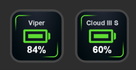
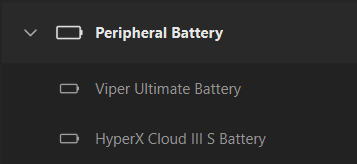

# Peripheral Battery for Stream Deck

**English** | [Español](README.md)

A Stream Deck plugin for Windows that shows the battery percentage of these devices on a key:

- **Razer Viper Ultimate** (wireless and wired)
- **HyperX Cloud III S Wireless** (2.4 GHz USB dongle)

It reads the devices **directly over HID**: it needs neither Razer Synapse nor HyperX NGENUITY, and no background server or script. Stream Deck starts the plugin on its own.

## What the key shows

| Situation | Icon and text |
|---|---|
| Above 50% | Green |
| 21% to 50% | Yellow |
| 20% or less | Red |
| Charging (Viper only) | Blue with a lightning bolt |
| Mouse asleep | Keeps the colored icon, percentage, and shows a crescent moon (`Viper 🌙`) |
| Headset switched off | Gray icon, gray percentage, and `"Apagados"` notice |
| Disconnected (no dongle) | Gray icon, gray percentage, and `"Desconectado"` notice |
| Starting up | Gray, with `"Leyendo..."` notice |

Each key shows the percentage under the battery and a label with the device name or current status. It refreshes every 30 seconds; pressing the key forces an immediate reading.

## Requirements

- Windows 10 or 11
- Stream Deck 6.4 or later
- To build: [.NET SDK](https://dotnet.microsoft.com/download) 8 or later (`winget install Microsoft.DotNet.SDK.8`)

The plugin itself targets .NET Framework 4.8, which already ships with Windows.

## Installation

1. Clone or download the repository.
2. Run `instalar.bat`. The script:
   - builds the project in Release mode,
   - closes Stream Deck,
   - copies the result to `%APPDATA%\Elgato\StreamDeck\Plugins\com.jose.razerbattery.sdPlugin`,
   - starts Stream Deck again.
3. In Stream Deck, open the **Batería periféricos** category and drag **Batería Viper Ultimate** and/or **Batería HyperX Cloud III S** onto a key. (The category and action names are in Spanish.)

To uninstall, delete that folder from `Plugins` while Stream Deck is closed.

## How it works

Each device has a monitor that polls the battery in the background and shares the result with every key that displays it.

### Razer Viper Ultimate

It uses Razer's 90-byte protocol sent as a *feature report* (`HidD_SetFeature` / `HidD_GetFeature`), opening the HID interface with access 0, the same way `hidapi` does.

- VID `0x1532`; PID `0x007A` (wired) and `0x007B` (wireless)
- Battery level: class `0x07`, command `0x80`; the answer is in `arguments[1]` (0–255, converted to %)
- Charging state: class `0x07`, command `0x84`
- Several *transaction IDs* are tried (`0x3F`, `0x1F`, `0xFF`) and the last one that worked is remembered

### HyperX Cloud III S Wireless

It uses the vendor collection `usage_page 0x01C0` on interface 3.

- VID `0x03F0`; PID `0x02CC` and `0x06BE` (two revisions of the same model)
- Report `0x0C` is sent with `02 03 01 00 06`; the percentage is in byte 6 of the answer
- A value above 100 means the headset is switched off
- Unsolicited reports that arrive on the same collection are ignored

## Limitations

- Windows only.
- The HyperX charging state is not shown: it is not known how to read it.
- Only tested with one Viper Ultimate and one Cloud III S Wireless with PID `0x02CC`. Other variants of the same model may need adjustments.
- If Razer Synapse or NGENUITY are open, they may compete for the device.

## Troubleshooting

The plugin writes a log to `%APPDATA%\Elgato\StreamDeck\Plugins\com.jose.razerbattery.sdPlugin\pluginlog.log`.

| Symptom | What to check |
|---|---|
| "Desconectado" (disconnected) / gray key | The dongle is not plugged in, or Windows can't see it |
| The percentage doesn't update while the device is active | The dongle answers but the reading fails (the last value stays on screen): move the mouse or switch the headset on and press the key; if it persists, check the log |
| The category doesn't appear | Check that `instalar.bat` finished without errors and restart Stream Deck |
| Package restore error | The project uses `StreamDeck-Tools 7.*` and `HidSharp 2.1.0` from NuGet |

The on-key notices are in Spanish: "sin dongle" means no dongle and "leyendo..." means reading.

## Project structure

| File | Purpose |
|---|---|
| `Program.cs` | Entry point; Stream Deck launches the exe with its arguments |
| `BatteryAction.cs` | Key actions (one per device) and drawing of the icon and text |
| `BatteryMonitor.cs` | Periodic background polling, one per device |
| `BatteryReading.cs` | Immutable result of one reading |
| `RazerHid.cs` | HID reading for the Viper Ultimate |
| `HyperXHid.cs` | HID reading for the Cloud III S Wireless |
| `manifest.json` | Plugin definition for Stream Deck |
| `Images/` | Key and plugin icons |
| `instalar.bat` | Builds and installs the plugin |

To add another device: create an `XxxHid` class with its reading logic, add a static `BatteryMonitor` with its polling function, an action class that inherits from `BatteryActionBase`, and the matching entry in `manifest.json`.

## Credits and references

- Razer protocol: documented by the [OpenRazer](https://github.com/openrazer/openrazer) project.
- Cloud III S Wireless battery protocol: documented by the community in [HeadsetControl issue #486](https://github.com/Sapd/HeadsetControl/issues/486) and verified on the author's hardware.
- [StreamDeck-Tools](https://github.com/BarRaider/streamdeck-tools) by BarRaider, for communication with Stream Deck.
- [HidSharp](https://www.zer7.com/software/hidsharp), for enumerating HID devices.

This is an independent project with no affiliation with Razer, HyperX/HP, Elgato or BarRaider. All trademarks belong to their respective owners.

## License

To be decided.
