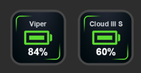
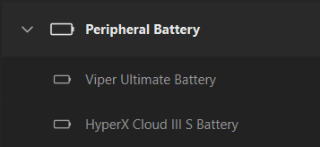

# Batería periféricos para Stream Deck

Plugin de Stream Deck para Windows que muestra en una tecla el porcentaje de batería de:

- **Razer Viper Ultimate** (inalámbrico y por cable)
- **HyperX Cloud III S Wireless** (dongle USB 2.4 GHz)

Lee los dispositivos **directamente por HID**: no necesita Razer Synapse ni HyperX NGENUITY, ni ningún servidor o script en segundo plano. Stream Deck arranca el plugin solo.

 

## Qué muestra la tecla

| Situación                     | Icono                                                      |
| ----------------------------- | ---------------------------------------------------------- |
| Más del 50 %                  | Verde                                                      |
| Entre 21 % y 50 %             | Amarillo                                                   |
| 20 % o menos                  | Rojo                                                       |
| Cargando (solo Viper)         | Azul con rayo                                              |
| Dispositivo dormido o apagado | Mantiene el icono de color y el último porcentaje conocido |
| Sin dongle o arrancando       | Gris, con un aviso (y el último valor si lo hubo)          |

Cada tecla lleva el porcentaje debajo de la batería y una etiqueta con el nombre del dispositivo. Se actualiza cada 30 segundos; al pulsar la tecla fuerza una lectura inmediata.

## Requisitos

- Windows 10 u 11
- Stream Deck 6.4 o superior
- Para compilar: [.NET SDK](https://dotnet.microsoft.com/download) 8 o superior (`winget install Microsoft.DotNet.SDK.8`)

El plugin en sí usa .NET Framework 4.8, que ya viene con Windows.

## Instalación

1. Clona o descarga el repositorio.
2. Ejecuta `instalar.bat`. El script:
   - compila el proyecto en modo Release,
   - cierra Stream Deck,
   - copia el resultado a `%APPDATA%\Elgato\StreamDeck\Plugins\com.jose.razerbattery.sdPlugin`,
   - vuelve a abrir Stream Deck.
3. En Stream Deck, abre la categoría **Batería periféricos** y arrastra a una tecla **Batería Viper Ultimate** y/o **Batería HyperX Cloud III S**.

Para desinstalarlo, borra esa carpeta de `Plugins` con Stream Deck cerrado.

## Cómo funciona

Cada dispositivo tiene un monitor que consulta la batería en segundo plano y comparte el resultado entre todas las teclas que lo muestren.

### Razer Viper Ultimate

Usa el protocolo Razer de 90 bytes enviado como _feature report_ (`HidD_SetFeature` / `HidD_GetFeature`), abriendo la interfaz HID con acceso 0 igual que hace `hidapi`.

- VID `0x1532`; PID `0x007A` (cable) y `0x007B` (inalámbrico)
- Nivel de batería: clase `0x07`, comando `0x80`; respuesta en `arguments[1]` (0–255, se convierte a %)
- Estado de carga: clase `0x07`, comando `0x84`
- Se prueban varios _transaction ID_ (`0x3F`, `0x1F`, `0xFF`) y se recuerda el último que funcionó

### HyperX Cloud III S Wireless

Usa la colección vendor `usage_page 0x01C0` de la interfaz 3.

- VID `0x03F0`; PID `0x02CC` y `0x06BE` (dos revisiones del mismo modelo)
- Se envía el report `0x0C` con `02 03 01 00 06`; el porcentaje viene en el byte 6 de la respuesta
- Un valor mayor de 100 indica que los auriculares están apagados
- Los reports no solicitados que llegan por la misma colección se ignoran

## Limitaciones

- Solo Windows.
- Con los HyperX no se muestra el estado de carga: no se conoce cómo leerlo.
- Solo se ha probado con un Viper Ultimate y con unos Cloud III S Wireless con PID `0x02CC`. Otras variantes del mismo modelo pueden necesitar ajustes.
- Si Razer Synapse o NGENUITY están abiertos, pueden competir por el dispositivo.

## Solución de problemas

El plugin escribe un log en `%APPDATA%\Elgato\StreamDeck\Plugins\com.jose.razerbattery.sdPlugin\pluginlog.log`.

| Síntoma                                                 | Qué mirar                                                                                                                                                                |
| ------------------------------------------------------- | ------------------------------------------------------------------------------------------------------------------------------------------------------------------------ |
| "sin dongle" / tecla gris                               | El dongle no está enchufado o Windows no lo ve                                                                                                                           |
| El porcentaje no se actualiza con el dispositivo activo | El dongle responde pero la lectura falla (se sigue mostrando el último valor): mueve el ratón o enciende los auriculares y pulsa la tecla; si sigue igual, revisa el log |
| La categoría no aparece                                 | Comprueba que `instalar.bat` terminó sin errores y reinicia Stream Deck                                                                                                  |
| Error al restaurar paquetes                             | El proyecto usa `StreamDeck-Tools 7.*` y `HidSharp 2.1.0` desde NuGet                                                                                                    |

## Estructura del proyecto

| Archivo             | Función                                                            |
| ------------------- | ------------------------------------------------------------------ |
| `Program.cs`        | Punto de entrada; Stream Deck lanza el exe con sus argumentos      |
| `BatteryAction.cs`  | Acciones de tecla (una por dispositivo) y dibujo del icono y texto |
| `BatteryMonitor.cs` | Sondeo periódico en segundo plano, uno por dispositivo             |
| `BatteryReading.cs` | Resultado inmutable de una lectura                                 |
| `RazerHid.cs`       | Lectura HID del Viper Ultimate                                     |
| `HyperXHid.cs`      | Lectura HID de los Cloud III S Wireless                            |
| `manifest.json`     | Definición del plugin para Stream Deck                             |
| `Images/`           | Iconos de las teclas y del plugin                                  |
| `instalar.bat`      | Compila e instala el plugin                                        |

Para añadir otro dispositivo: crea una clase `XxxHid` con su lectura, añade un `BatteryMonitor` estático con su función de sondeo, una clase de acción que herede de `BatteryActionBase` y la entrada correspondiente en `manifest.json`.

## Créditos y referencias

- Protocolo Razer: documentado por el proyecto [OpenRazer](https://github.com/openrazer/openrazer).
- Protocolo de batería de los Cloud III S Wireless: documentado por la comunidad en el [issue #486 de HeadsetControl](https://github.com/Sapd/HeadsetControl/issues/486) y comprobado en el equipo del autor.
- [StreamDeck-Tools](https://github.com/BarRaider/streamdeck-tools) de BarRaider, para la comunicación con Stream Deck.
- [HidSharp](https://www.zer7.com/software/hidsharp), para enumerar dispositivos HID.

Proyecto independiente, sin relación con Razer, HyperX/HP, Elgato ni BarRaider. Todas las marcas pertenecen a sus propietarios.

## Licencia

Por definir.
